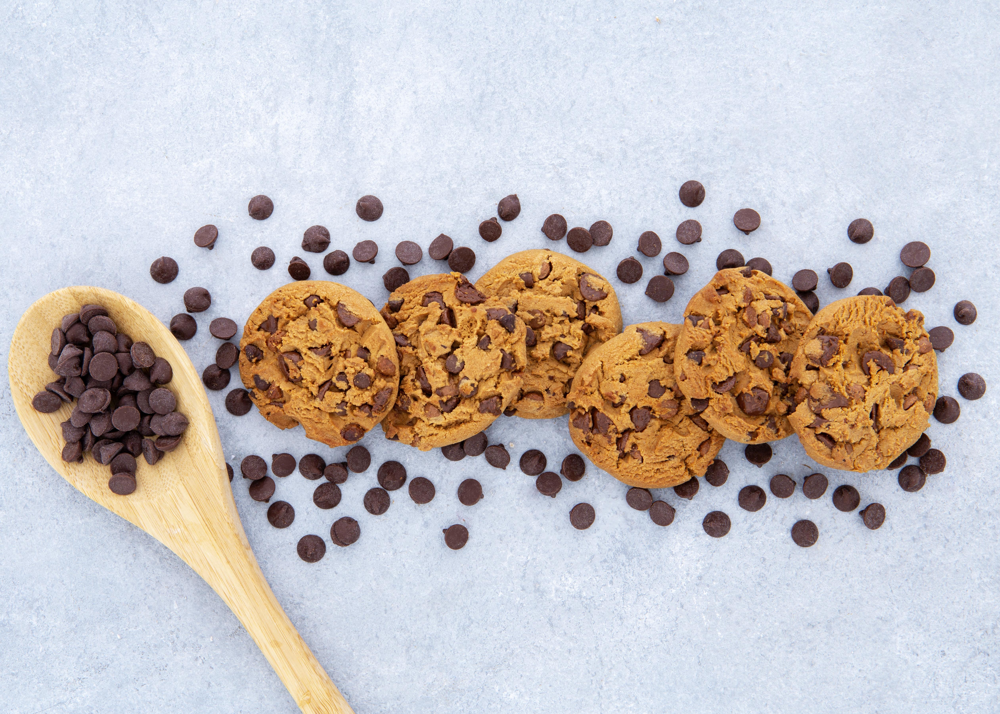

# Chocolate Chip Cookies

Chocolate Chip Cookies are a good recipe to keep in a baking collection because they offer a different flavor, texture, or technique from the other treats in this category. This page includes a starting recipe, what to watch for in the oven, and small adjustments that can help you get consistent results. Oven temperatures and pan sizes matter, so check your bake as it nears the suggested time.

## Recipe at a glance

- **Yield:** About 24 cookies
- **Oven:** 350°F (175°C)
- **Bake time:** 10–12 minutes
- **Equipment:** Mixing bowls, measuring tools, parchment paper, baking pan or sheet, and a cooling rack

## Ingredients

- **1 cup (226 g)** unsalted butter, softened
- **3/4 cup** granulated sugar
- **3/4 cup** packed brown sugar
- **2** large eggs
- **2 teaspoons** vanilla extract
- **2 1/4 cups** all-purpose flour
- **1 teaspoon** baking soda
- **1 teaspoon** salt
- **2 cups** semisweet chocolate chips

## Instructions

1. Cream the butter with both sugars until smooth and slightly fluffy.
2. Beat in the eggs one at a time, then stir in the vanilla.
3. Whisk the flour, baking soda, and salt in a separate bowl. Add the dry mixture to the wet mixture just until no flour streaks remain.
4. Fold in the chocolate chips. Chill the dough for 20–30 minutes if it feels very soft.
5. Scoop rounded tablespoons of dough onto parchment-lined baking sheets, leaving room for spreading.
6. Bake until the edges are golden and the centers still look slightly soft. Cool on the pan for five minutes before transferring to a rack.

## What makes this recipe work

For chewy cookies, measure flour carefully and avoid baking until the centers look completely dry. Brown sugar helps hold moisture, while the white sugar encourages spreading and crisp edges. A chilled dough usually spreads less than a warm one. If one tray browns faster than another, bake one sheet at a time on the center rack.

### Common problems and fixes

A cookie that spreads into a thin puddle may have had overly warm butter or too little flour. If the cookies turn out cakey, check that you did not add extra flour while measuring.

> **Baking note:** Start checking a few minutes before the listed time. Ovens vary, and the appearance of the edges and center is often a better guide than the timer alone.

## Related recipes

[[oatmeal-raisin-cookies|Oatmeal Raisin Cookies]] uses a similar drop-cookie method, while [[sugar-cookies|Sugar Cookies]] are better when you want a shape that holds its edges.

Return to the [[index|Cookies and Bars category]].
