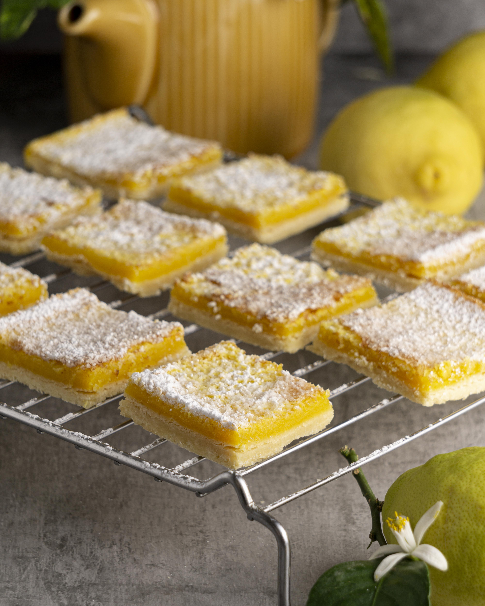

# Lemon Bars

Lemon Bars are a good recipe to keep in a baking collection because they offer a different flavor, texture, or technique from the other treats in this category. This page includes a starting recipe, what to watch for in the oven, and small adjustments that can help you get consistent results. Oven temperatures and pan sizes matter, so check your bake as it gets close to the suggested time.

## Recipe at a glance

- **Yield:** One 8-inch pan, about 16 bars
- **Oven:** 350°F (175°C)
- **Bake time:** 20 minutes for crust; 18–22 minutes for filling
- **Equipment:** Mixing bowls, measuring tools, parchment paper, baking pan or sheet, and a cooling rack

## Ingredients

- **1 cup** all-purpose flour, for crust
- **1/4 cup** powdered sugar, for crust
- **1/2 cup (113 g)** cold unsalted butter, for crust
- **1 cup** granulated sugar, for filling
- **2** large eggs, for filling
- **1/3 cup** fresh lemon juice, for filling
- **2 tablespoons** all-purpose flour, for filling
- **1 tablespoon** finely grated lemon zest, for filling

## Instructions

1. Line an 8-inch square baking pan with parchment and heat the oven.
2. Combine crust flour and powdered sugar. Cut in cold butter until the mixture resembles coarse crumbs.
3. Press the crumbs firmly and evenly into the pan. Bake for about 20 minutes until lightly golden.
4. While the crust bakes, whisk sugar, eggs, lemon juice, flour, and zest until smooth.
5. Pour the filling over the warm crust and return to the oven for 18–22 minutes, until the center is just set.
6. Cool to room temperature, then refrigerate for at least two hours before cutting. Dust with powdered sugar just before serving if desired.

## What makes this recipe work

Lemon bars work because a buttery shortbread base balances a sweet, tart filling. Fresh lemon juice gives a brighter flavor than bottled juice, and the zest adds citrus aroma without extra liquid. Press the crust evenly so one corner does not become much thicker than another. Refrigerating the bars is not just for convenience: it helps the filling firm up enough to cut cleanly.

### Common problems and fixes

If the filling is runny after chilling, it may have been underbaked. If the crust crumbles, it may not have been pressed firmly enough. Use parchment overhang to lift the whole slab before slicing.

> **Baking note:** Start checking a few minutes before the listed time. Ovens vary, and the appearance of the edges and center is often a better guide than the timer alone.

## Related recipes

If you like desserts that can be sliced into squares, explore [[fudgy-brownies|Fudgy Brownies]]. For a cookie that can be cut into decorative shapes, see [[sugar-cookies|Sugar Cookies]].

Return to the [[index|Cookies and Bars category]].
