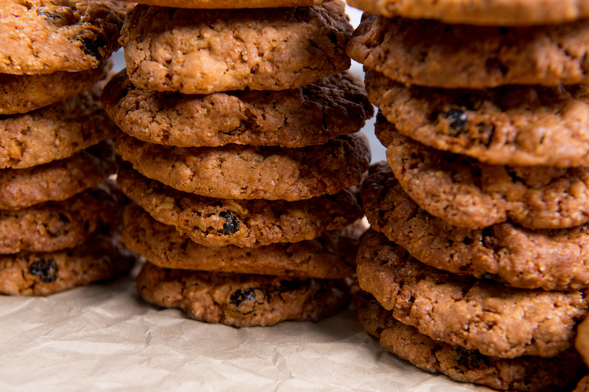

# Oatmeal Raisin Cookies

Oatmeal Raisin Cookies are a good recipe to keep in a baking collection because they offer a different flavor, texture, or technique from the other treats in this category. This page includes a starting recipe, what to watch for in the oven, and small adjustments that can help you get consistent results. Oven temperatures and pan sizes matter, so check your bake as it gets close to the suggested time.

## Recipe at a glance

- **Yield:** About 24 cookies
- **Oven:** 350°F (175°C)
- **Bake time:** 10–12 minutes
- **Equipment:** Mixing bowls, measuring tools, parchment paper, baking pan or sheet, and a cooling rack

## Ingredients

- **1/2 cup (113 g)** unsalted butter, softened
- **1/2 cup** packed brown sugar
- **1/4 cup** granulated sugar
- **1** large egg
- **1 teaspoon** vanilla extract
- **3/4 cup** all-purpose flour
- **1/2 teaspoon** baking soda
- **1/2 teaspoon** ground cinnamon
- **1/4 teaspoon** salt
- **1 1/2 cups** old-fashioned rolled oats
- **3/4 cup** raisins

## Instructions

1. Cream the butter with the brown and granulated sugars. Beat in the egg and vanilla.
2. In another bowl, mix flour, baking soda, cinnamon, and salt.
3. Stir the dry mixture into the butter mixture, then fold in the oats and raisins.
4. Let the dough rest for ten minutes while the oven heats; the oats will absorb some moisture.
5. Scoop rounded tablespoons onto parchment-lined baking sheets with space between each cookie.
6. Bake until the edges are golden and the centers look set but still soft. Leave on the pan briefly before cooling on a rack.

## What makes this recipe work

Old-fashioned rolled oats give these cookies a chewy bite and more texture than a plain flour cookie. Quick oats absorb liquid differently and may produce a softer, more uniform cookie, so rolled oats are the first choice here. Raisins add sweetness and moisture; if they are very dry, soak them in warm water for five minutes and pat them dry before mixing. Cinnamon adds warmth without overpowering the oats.

### Common problems and fixes

If cookies crumble, check whether the oats or flour were overmeasured. If they spread too far, chill the dough briefly. Do not confuse a soft center right out of the oven with underbaking; the cookies firm up as they cool.

> **Baking note:** Start checking a few minutes before the listed time. Ovens vary, and the appearance of the edges and center is often a better guide than the timer alone.

## Related recipes

See [[content/cookies-and-bars/chocolate-chip-cookies|Chocolate Chip Cookies]] for another classic drop cookie. If you want a cookie you can roll and decorate instead, try [[sugar-cookies|Sugar Cookies]].

Return to the [[index|Cookies and Bars category]].
